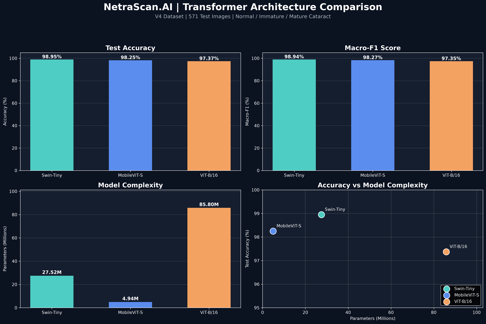
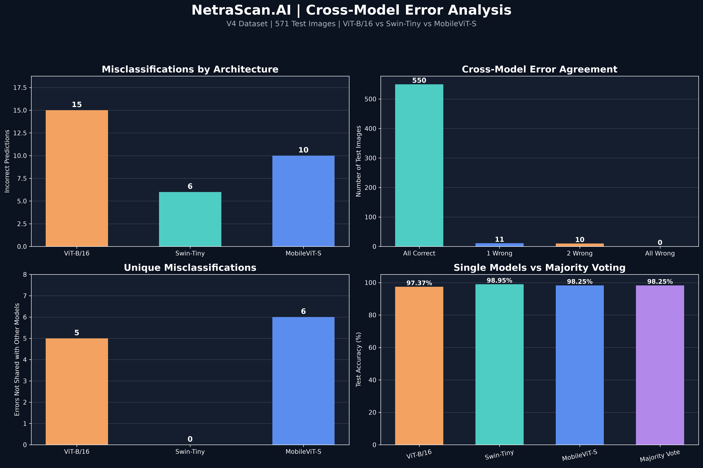
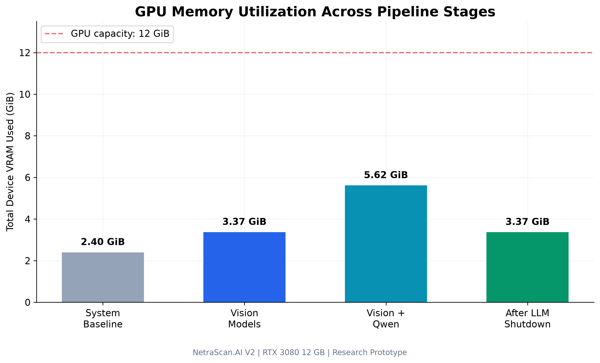
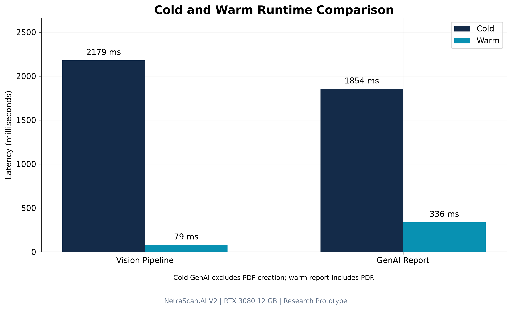
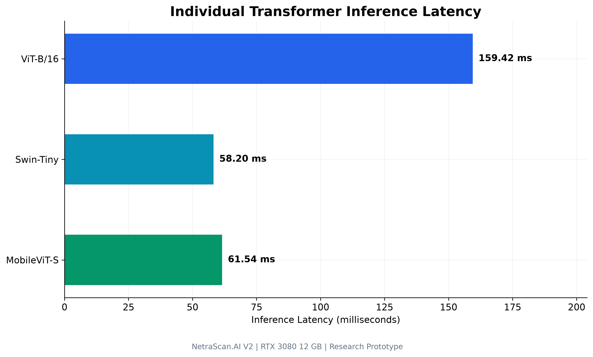
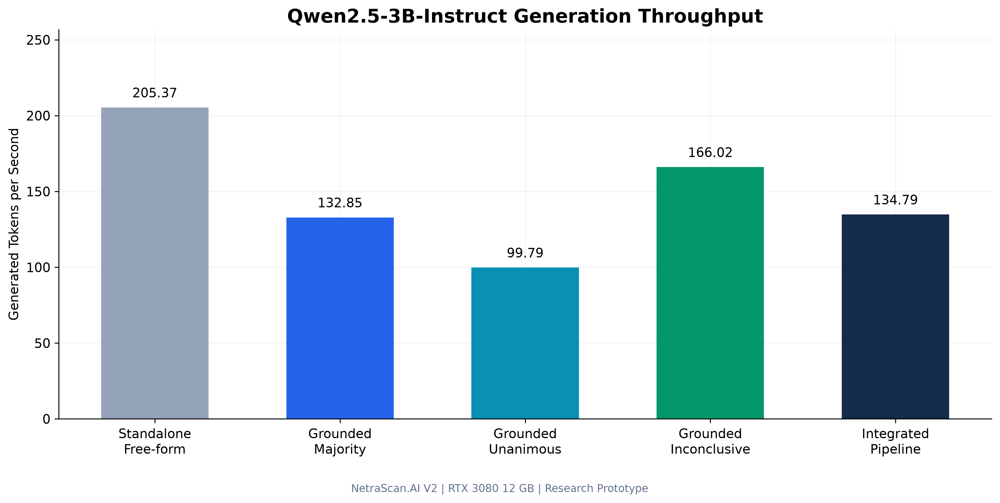
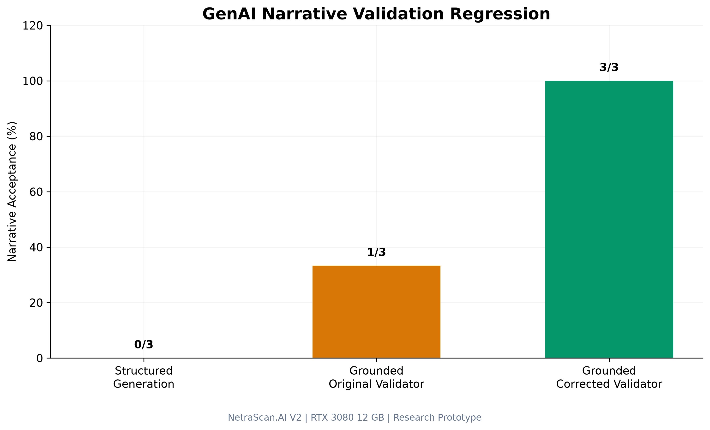
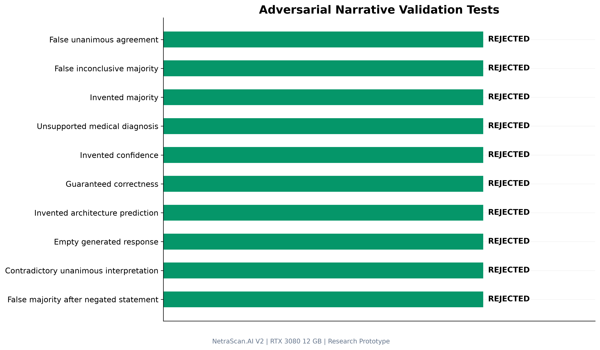

# NetraScan.AI V2 - Experimental Benchmarks

**Developed by Mr. SHOBHIT JAIN**

This document presents the classification evaluation, computational
performance and local generative AI validation results of NetraScan.AI V2.

---

## 1. Classification Evaluation

Dataset: V4
Held-out test samples: 571
Classification categories: Normal, Immature Cataract, Mature Cataract

| Architecture | Accuracy | Macro Precision | Macro Recall | Macro F1 | Parameters |
|---|---:|---:|---:|---:|---:|
| ViT-B/16 | 97.37% | 97.62% | 97.28% | 97.35% | 85,800,963 |
| Swin-Tiny | 98.95% | 99.00% | 98.91% | 98.94% | 27,521,661 |
| MobileViT-S | 98.25% | 98.34% | 98.24% | 98.27% | 4,939,555 |
| Majority Voting | 98.25% | - | - | - | - |

### Parameter Efficiency

MobileViT-S contains approximately 17.37 times fewer parameters
than ViT-B/16 and 5.57 times fewer parameters than Swin-Tiny.

Despite its smaller parameter count, MobileViT-S achieved 98.25%
held-out test accuracy.

Swin-Tiny achieved the highest individual classification accuracy.

## 2. Cross-Model Error Analysis

| Architecture | Correct Predictions | Errors |
|---|---:|---:|
| ViT-B/16 | 556 | 15 |
| Swin-Tiny | 565 | 6 |
| MobileViT-S | 561 | 10 |
| Majority Voting | 561 | 10 |

| Agreement category | Images |
|---|---:|
| All models correct | 550 |
| Exactly one model incorrect | 11 |
| Exactly two models incorrect | 10 |
| All models incorrect | 0 |

Majority voting corrected the single-model errors on 11 images.
However, it did not outperform the strongest individual architecture.

The ensemble is retained to provide cross-architecture agreement
information rather than guarantee improved accuracy.

## 3. Reference Hardware and Software

| Component | Configuration |
|---|---|
| CPU | Intel Core i7-12700K |
| GPU | NVIDIA GeForce RTX 3080 |
| GPU memory | 12 GB |
| System memory | 64 GB |
| Python | 3.11.5 |
| PyTorch | 2.9.0+cu128 |
| Torchvision | 0.24.0+cu128 |
| CUDA build | 12.8 |
| timm | 1.0.22 |
| Gradio | 6.32.0 |
| Local inference backend | llama.cpp b12716 |
| Language model | Qwen2.5-3B-Instruct |
| Quantization | Q4_K_M |
| Context window | 4096 tokens |

## 4. GPU Memory Utilization

| Runtime state | Observed GPU memory |
|---|---:|
| Initial baseline | 2458 MiB |
| Vision pipeline initialized | 3451 MiB |
| Vision and local LLM initialized | 5750 MiB |
| After releasing local LLM | 3448 MiB |

### Incremental GPU Memory

| Component | Observed increase |
|---|---:|
| Vision pipeline | 993 MiB |
| Local LLM | 2299 MiB |
| Combined workload | 3292 MiB |
| Memory released after LLM shutdown | 2302 MiB |

The combined workload increased GPU memory usage by approximately
3.21 GiB above the initial system baseline.

These measurements represent observed device-wide memory usage,
including background allocations. They are not isolated measurements
of model weight storage.

## 5. Cold and Warm Execution Latency

| Operation | Observed latency |
|---|---:|
| Cold vision pipeline | 2179 ms |
| Warm vision pipeline | 79 ms |
| Cold GenAI operation, excluding PDF | 1854 ms |
| Warm report generation, including PDF | 336 ms |

The warm vision pipeline benefits from already initialized models.

The cold GenAI and warm report measurements have different
operation boundaries and must not be interpreted as directly
equivalent workloads.

Browser rendering and user interaction delays are not included.

## 6. Individual Transformer Inference Latency

| Architecture | Observed inference latency |
|---|---:|
| ViT-B/16 | 159.42 ms |
| Swin-Tiny | 58.20 ms |
| MobileViT-S | 61.54 ms |

These observations were recorded during the integrated cold vision
test and do not represent averaged steady-state inference benchmarks.

## 7. Local Language Model Throughput

| Generation scenario | Generated tokens/second |
|---|---:|
| Standalone generation | 205.37 |
| Grounded majority agreement | 132.85 |
| Grounded unanimous agreement | 99.79 |
| Grounded inconclusive agreement | 166.02 |
| Integrated application generation | 134.79 |

Generation throughput depends on prompt length, output length,
GPU utilization and backend execution state.

## 8. Grounded Narrative Validation

| Validation experiment | Accepted | Total |
|---|---:|---:|
| Initial structured generation | 0 | 3 |
| Grounded generation with original validator | 1 | 3 |
| Grounded generation with corrected validator | 3 | 3 |

The corrected validator was evaluated against the same grounded
regression examples.

The results demonstrate correction of observed validation defects,
not generalization to all possible language model outputs.

## 9. Adversarial Narrative Validation

| Metric | Result |
|---|---:|
| Constructed adversarial examples | 10 |
| Rejected examples | 10 |
| Accepted adversarial examples | 0 |
| Observed rejection rate | 100% |

The application uses deterministic fact verification, constrained
generation, narrative validation and deterministic fallback.

The observed rejection rate applies only to the constructed
regression test set and does not establish universal hallucination
prevention or adversarial robustness.

## 10. Benchmark Methodology and Limitations

- Classification metrics use the V4 held-out test partition.
- Individual model prediction counts were verified against original
  evaluation records.
- Ensemble accuracy was calculated from original cross-model records.
- Runtime measurements were obtained from controlled engineering tests.
- Runtime results are individual reference observations, not repeated
  statistically averaged measurements.
- Integrated runtime testing used a synthetic input image.
- Cold and warm measurements are distinguished where applicable.
- Device-wide GPU memory includes existing system allocations.
- Confidence values are not clinically calibrated probabilities.
- Patient-level independence and external clinical validity have
  not been established.
- Narrative regression tests cover a limited set of constructed cases.

## 11. Reproducibility Artifacts

- [Benchmark summary](benchmarks/benchmark_summary.json)
- [Benchmark figures](benchmarks/figures/)
- [ViT-B/16 evaluation](results/vit_v4/)
- [Swin-Tiny evaluation](results/swin_v4/)
- [MobileViT-S evaluation](results/mobilevit_v4/)
- [Cross-model comparison](results/comparison_v4/)
- [Research notebook](notebooks/NetraScanAI.ipynb)
- [Local LLM manifest](llm/manifest.json)

---

NetraScan.AI is an academic research prototype and is not intended
for independent clinical diagnosis.

**Three Transformers. One Vision.**
