<div align="center">

# NetraScan.AI V2

### Three Transformers. One Vision.

**Multi-Transformer Cataract Classification, Explainable AI and Local Generative AI**


**Created and developed by Mr. SHOBHIT JAIN**

</div>

---

## 1. Project Overview

NetraScan.AI is an academic AI research prototype that investigates
transformer-based image classification for cataract assessment.

The system integrates three distinct vision transformer architectures,
majority-voting ensemble inference, Grad-CAM explainability and a locally
executed generative language model.

The classification pipeline categorizes eye images into three classes:

- Normal
- Immature Cataract
- Mature Cataract

Version 2 extends the original classification system with grounded local
generative AI, automated PDF research reports, narrative validation,
runtime performance analysis and offline portable deployment.

> This project is intended for academic research and demonstration.
> It is not a clinically validated medical device or a substitute for
> professional ophthalmological examination.

## 2. Key Features

- Three independently trained vision transformer architectures.
- Majority-voting ensemble with explicit model agreement reporting.
- Per-model class probabilities, confidence scores and inference latency.
- Swin-Tiny Grad-CAM heatmaps and activation overlays.
- Local Qwen2.5-3B-Instruct generative AI.
- Structured factual grounding and narrative validation.
- Deterministic reporting fallback when generation fails validation.
- Downloadable PDF research reports.
- Interactive Gradio interface with image upload and webcam input.
- Lazy model initialization and local LLM resource management.
- NVIDIA CUDA acceleration.
- Offline portable deployment after required artifacts are provisioned.

## 3. System Architecture

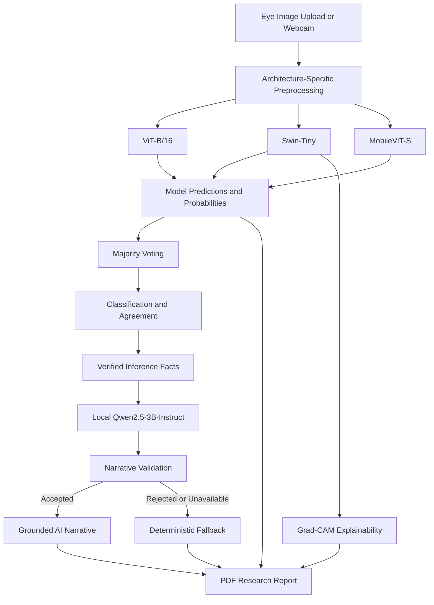

The vision models remain responsible for classification. The language
model does not independently diagnose cataracts or modify model predictions.

## 4. Dataset Engineering

The V4 dataset contains 3,542 images consolidated from two cataract
image collections.

| Dataset partition | Normal | Immature | Mature | Total |
|---|---:|---:|---:|---:|
| Training | 799 | 837 | 818 | 2,454 |
| Validation | 178 | 164 | 175 | 517 |
| Testing | 192 | 195 | 184 | 571 |
| Total | 1,169 | 1,196 | 1,177 | 3,542 |

### Dataset preparation

The dataset engineering pipeline includes:

- Three-class label harmonization.
- SHA-256 exact duplicate identification.
- Perceptual hashing for visually similar images.
- Visual family grouping.
- Group-aware dataset partitioning.
- Cross-partition integrity checks.
- Architecture-specific image preprocessing.

### V4 integrity checks

| Integrity criterion | Result |
|---|---:|
| Visual families | 2,746 |
| Visual families crossing partitions | 0 |
| Cross-partition pHash pairs at distance <= 4 | 0 |
| Cross-partition Roboflow lineages | 0 |
| Missing image paths during dataset verification | 0 |

These checks reduce identifiable dataset leakage risks but do not
establish complete independence at the patient level.

## 5. Model Architectures

| Architecture | Input resolution | Parameters |
|---|---:|---:|
| ViT-B/16 | 224 x 224 | 85,800,963 |
| Swin-Tiny | 224 x 224 | 27,521,661 |
| MobileViT-S | 256 x 256 | 4,939,555 |

### Vision Transformer (ViT-B/16)

ViT divides an image into fixed-size patches and processes patch
embeddings using transformer encoder blocks and global self-attention.

### Swin Transformer (Swin-Tiny)

Swin employs hierarchical feature representations and shifted-window
self-attention to capture local and progressively broader spatial features.

### MobileViT-S

MobileViT combines convolutional feature extraction with transformer-based
global representation learning in a compact architecture.

### Training configuration

| Hyperparameter | Configuration |
|---|---|
| Maximum epochs | 10 |
| Batch size | 16 |
| Learning rate | 2e-5 |
| Weight decay | 0.01 |
| Optimizer | AdamW |
| Loss function | CrossEntropyLoss |
| Early stopping patience | 3 |
| Mixed precision | Enabled |

Individual experiment configurations are available in the results directory.

## 6. Experimental Results

All reported classification results below are based on the V4 held-out
test partition containing 571 images.

| Model | Accuracy | Macro Precision | Macro Recall | Macro F1 | Correct | Errors |
|---|---:|---:|---:|---:|---:|---:|
| ViT-B/16 | 97.37% | 97.62% | 97.28% | 97.35% | 556 | 15 |
| Swin-Tiny | **98.95%** | **99.00%** | **98.91%** | **98.94%** | **565** | **6** |
| MobileViT-S | 98.25% | 98.34% | 98.24% | 98.27% | 561 | 10 |
| Majority Voting | 98.25% | - | - | - | 561 | 10 |

Swin-Tiny achieved the highest individual test accuracy.
MobileViT-S achieved competitive performance with approximately
4.94 million parameters.

The majority-voting ensemble exceeded ViT-B/16 accuracy, matched
MobileViT-S accuracy and remained below Swin-Tiny accuracy.

### Model comparison dashboard

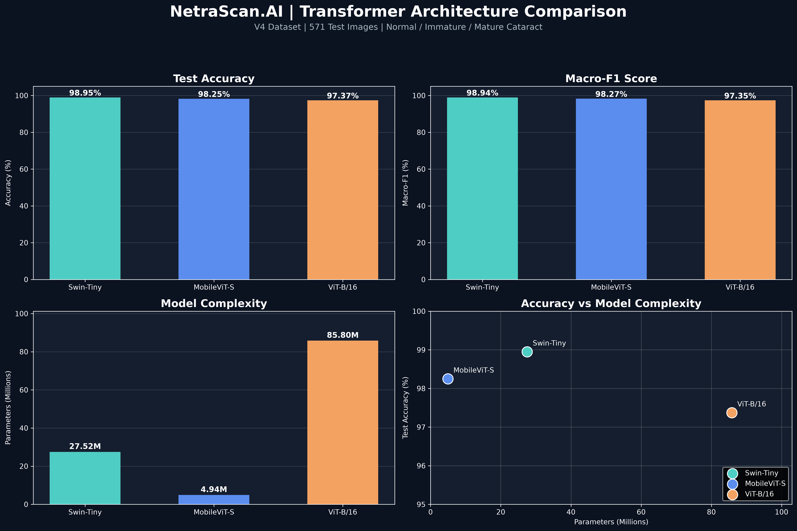

### Training curves and confusion matrices

| Architecture | Training curve | Test confusion matrix |
|---|---|---|
| ViT-B/16 | 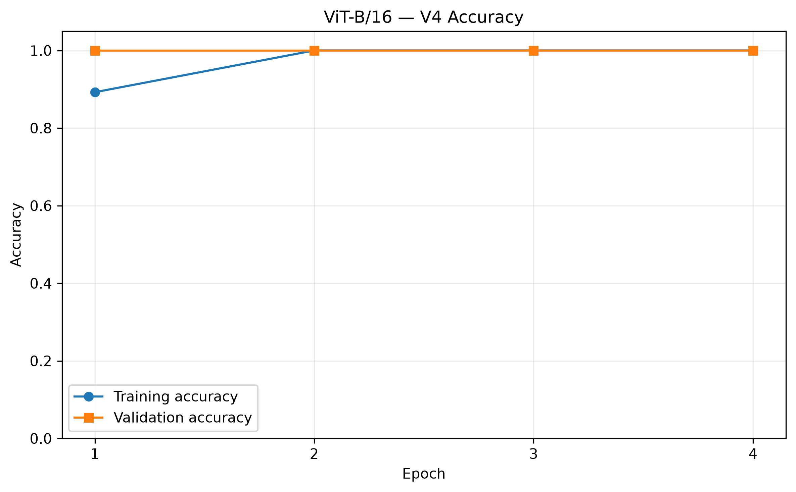 |  |
| Swin-Tiny | 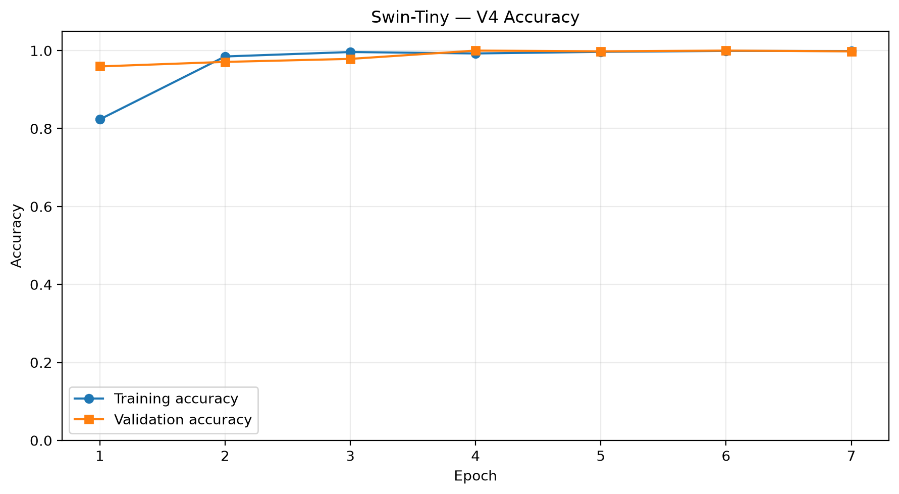 | 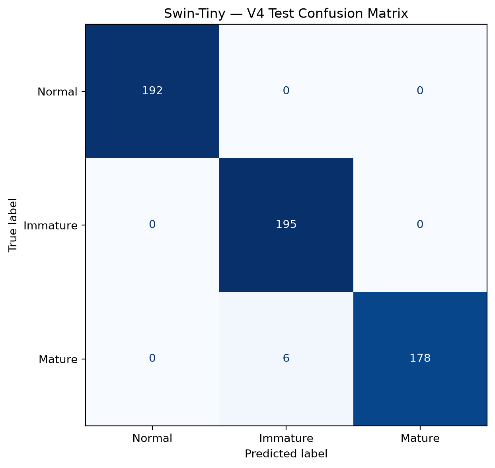 |
| MobileViT-S | 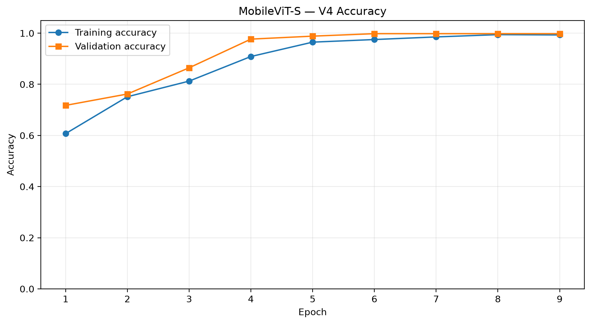 | 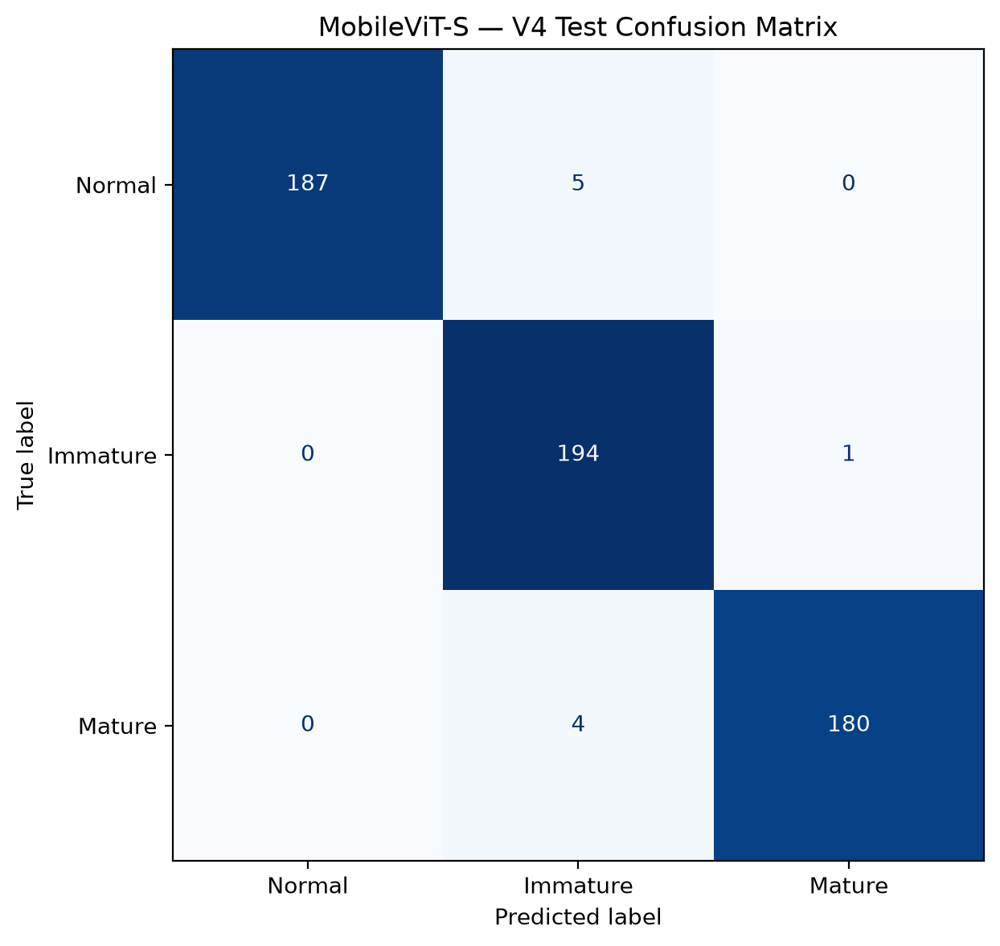 |

### Cross-model error analysis

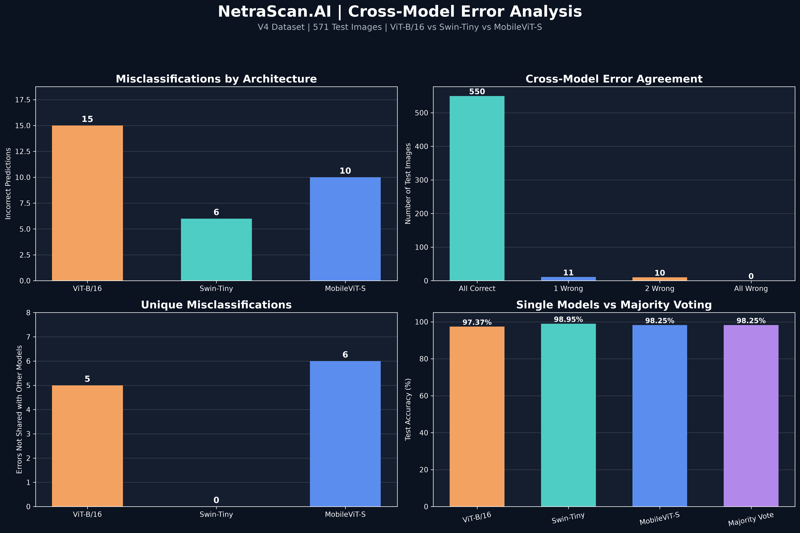

| Error agreement | Test images |
|---|---:|
| All three models correct | 550 |
| Exactly one model incorrect | 11 |
| Exactly two models incorrect | 10 |
| All three models incorrect | 0 |

The ensemble provides a mechanism for inspecting agreement between
architectures rather than guaranteeing improved classification accuracy.

Sanitized per-image predictions, aggregate metrics, training histories
and experiment configurations are included in the results directory.

## 7. Explainable AI

NetraScan.AI uses Gradient-weighted Class Activation Mapping (Grad-CAM)
with Swin-Tiny to generate class-specific spatial activation maps.

The explanation pipeline:

1. Performs a forward pass through Swin-Tiny.
2. Selects the predicted class as the explanation target.
3. Extracts intermediate activations and corresponding gradients.
4. Reshapes transformer feature representations into spatial maps.
5. Computes and normalizes the class activation map.
6. Produces a heatmap and an overlay on the original image.

Grad-CAM visualizations indicate regions associated with model
predictions. They do not establish causal reasoning, lesion boundaries
or clinically validated anatomical localization.

## 8. Local Generative AI

Version 2 introduces a fully local report-generation pipeline using
Qwen2.5-3B-Instruct through llama.cpp.

| Component | Configuration |
|---|---|
| Language model | Qwen2.5-3B-Instruct |
| Parameters | Approximately 3 billion |
| Quantization | Q4_K_M |
| Format | GGUF |
| Inference backend | llama.cpp |
| Backend release | b12716 |
| Context window | 4,096 tokens |
| GGUF file size | Approximately 2.10 GB |

### Grounded generation pipeline


The application independently verifies model predictions, probability
distributions, confidence values and ensemble agreement before report
generation.

The language model receives constrained facts and generates a short
interpretive narrative. Numerical results and classification labels
remain under deterministic application control.

Generated narratives are checked for unsupported claims, contradictory
agreement descriptions and other prohibited content.

When validation fails, or the local backend is unavailable during
generation, the application can use a deterministic fallback narrative.

This architecture reduces observed grounding failures but does not
guarantee hallucination-free language generation.

## 9. Runtime Performance

Reference environment:

| Component | Specification |
|---|---|
| GPU | NVIDIA GeForce RTX 3080 12 GB |
| CPU | Intel Core i7-12700K |
| System memory | 64 GB |
| Python | 3.11.5 |
| PyTorch | 2.9.0+cu128 |
| CUDA build | 12.8 |

### GPU memory utilization

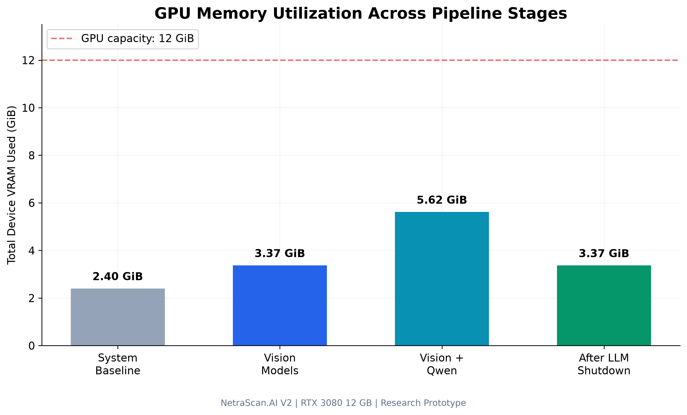

| Runtime state | GPU memory used |
|---|---:|
| Initial system baseline | 2,458 MiB |
| Vision pipeline initialized | 3,451 MiB |
| Vision pipeline and local LLM | 5,750 MiB |
| After releasing local LLM | 3,448 MiB |

The combined workload increased measured GPU memory usage by
approximately 3.21 GiB above the initial system baseline.

### Cold and warm execution latency

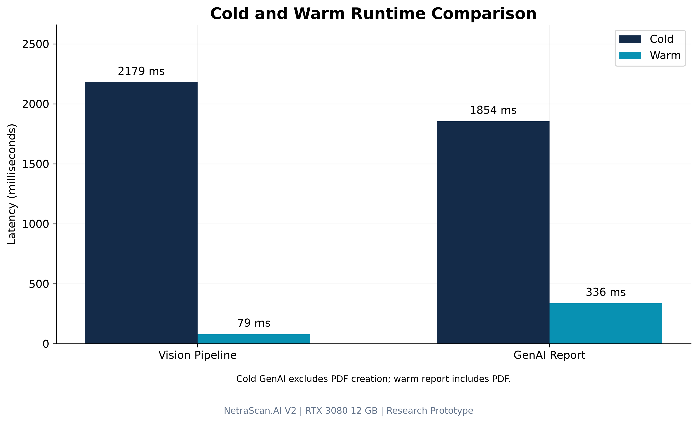

| Operation | Observed latency |
|---|---:|
| Cold vision pipeline | 2,179 ms |
| Warm vision pipeline | 79 ms |
| Cold GenAI operation, excluding PDF | 1,854 ms |
| Warm report generation, including PDF | 336 ms |

Cold GenAI and warm report measurements have different operation
boundaries and should not be interpreted as a strictly equivalent
speedup comparison.

### Individual transformer inference latency

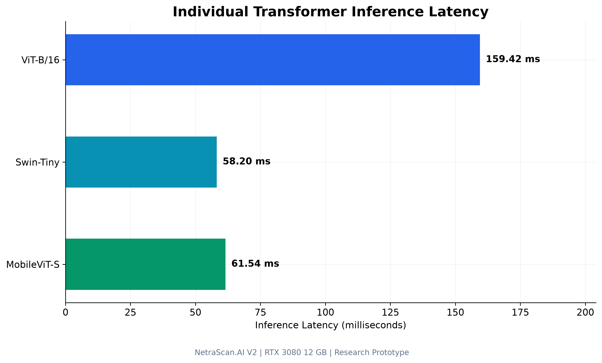

### Local language model throughput

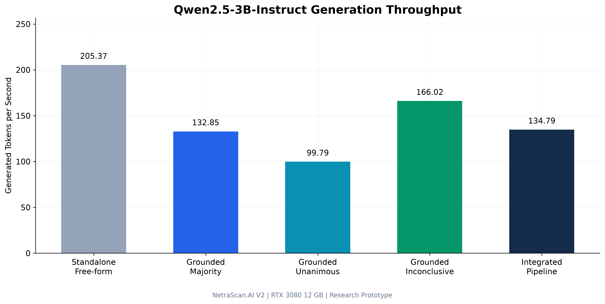

The integrated local GenAI test recorded approximately 134.79
generated tokens per second.

### Narrative validation

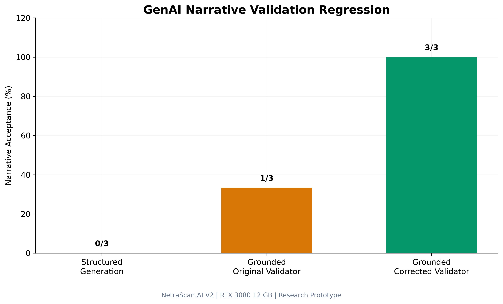

The corrected validator accepted all three previously generated
grounded regression examples.

### Adversarial validation

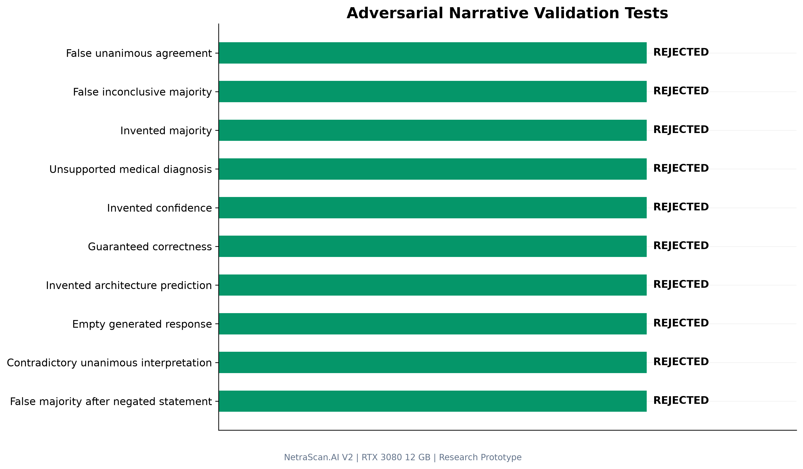

All ten deliberately constructed adversarial narratives were rejected
by the validator in the regression test.

These are limited engineering tests, not comprehensive guarantees
of language model safety or reliability.

Runtime measurements are reference observations from controlled
engineering tests rather than statistically averaged benchmarks.
Performance varies with hardware, drivers, workload and system state.

## 10. Automated PDF Research Reports

The reporting pipeline generates structured PDF documents containing:

- Ensemble classification and model agreement.
- Individual model predictions and confidence values.
- Per-class probability distributions.
- Model inference latency.
- Original input image and available Grad-CAM visualizations.
- Validated local AI narrative or deterministic fallback.
- Report identifier, methodology and research limitations.

Report generation verifies that the current input image matches
the previously analyzed image.

Reports are generated locally and are excluded from version control.

## 11. Repository Structure

```text
NetraScan.AI/
|
|-- app.py
|-- requirements.txt
|-- START_NETRASCAN.bat
|-- README.md
|
|-- src/
|   |-- inference.py
|   |-- explainability.py
|   |-- llm_reporter.py
|   |-- pdf_reporter.py
|   `-- report_generator.py
|
|-- notebooks/
|   `-- NetraScanAI.ipynb
|
|-- data/
|   `-- metadata/
|
|-- docs/
|
|-- results/
|   |-- vit_v4/
|   |-- swin_v4/
|   |-- mobilevit_v4/
|   `-- comparison_v4/
|
|-- benchmarks/
|   |-- benchmark_summary.json
|   `-- figures/
|
`-- llm/
    `-- manifest.json
```

Model weights, raw image datasets, portable Python runtime files,
LLM binaries, private images and generated reports are not bundled
with the public source repository.

## 12. Installation and Setup

### Clone the repository

```bash
git clone https://github.com/ShobhitJain2197/NetraScan.AI.git
cd NetraScan.AI
```

### Create a Python environment

Windows PowerShell:

```powershell
py -3.11 -m venv .venv
.\.venv\Scripts\Activate.ps1
python -m pip install --upgrade pip
```

### Install CUDA-enabled PyTorch

For the reference NVIDIA CUDA 12.8 environment:

```bash
python -m pip install torch==2.9.0 torchvision==0.24.0 --index-url https://download.pytorch.org/whl/cu128
```

Install the remaining application dependencies:

```bash
python -m pip install -r requirements.txt
```

Verify CUDA availability:

```bash
python -c "import torch; print(torch.__version__); print(torch.cuda.is_available())"
```

A compatible NVIDIA driver is required for the reference GPU setup.

### Provision vision checkpoints

Place the trained checkpoints at the following relative paths:

```text
models/
|-- vit_v4/
|   `-- vit_v4_best.pth
|-- swin_v4/
|   `-- swin_v4_best.pth
`-- mobilevit_v4/
    `-- mobilevit_v4_best.pth
```

The original trained checkpoints are not distributed in this repository.
Compatible checkpoints must be obtained separately or reproduced using
the documented training pipeline and dataset.

### Provision the local language model

Download the GGUF model from:

[Qwen2.5-3B-Instruct-GGUF](https://huggingface.co/Qwen/Qwen2.5-3B-Instruct-GGUF)

Use the model revision and Q4_K_M artifact specified in
[llm/manifest.json](llm/manifest.json).

Place the model at:

```text
llm/weights/qwen2.5-3b-instruct-q4_k_m.gguf
```

Download the Windows CUDA 12.4 x64 llama.cpp backend and matching
CUDA runtime archives for release b12716 from:

[llama.cpp Releases](https://github.com/ggml-org/llama.cpp/releases)

Extract the backend executable and required runtime libraries into:

```text
llm/backend/
```

The expected executable is:

```text
llm/backend/llama-server.exe
```

Verify downloaded artifacts against the SHA-256 checksums in the
manifest before use.

### Launch the application

After provisioning the required model artifacts:

```powershell
$env:MPLBACKEND = "Agg"
python app.py
```

Open the local application at:

http://127.0.0.1:7860

The application runs locally without creating a public Gradio share link.

## 13. Portable Deployment

NetraScan.AI supports a separately provisioned Windows portable
deployment containing an independent Python runtime, vision checkpoints,
local language model and required inference libraries.

The portable installation can execute from an external SSD without
installing Python on the host system.

Compatible operating system, GPU drivers and sufficient system
resources are still required.

Once all required artifacts are available, classification and local
report generation do not require a cloud inference API.

The complete portable runtime is not included in this source repository.

## 14. Research Limitations

- Evaluation is restricted to the available V4 dataset.
- Internal held-out performance does not establish clinical validity.
- Patient-level independence has not been established.
- Performance on unfamiliar cameras, lighting conditions and clinical
  populations requires further evaluation.
- Ensemble voting does not necessarily outperform the strongest
  individual architecture.
- Model confidence values are not validated clinical probabilities.
- Grad-CAM is an attribution visualization rather than a diagnostic
  localization method.
- Narrative validation reduces tested failure modes but cannot guarantee
  the absence of unsupported generated content.

## 15. Version History

### V2.0.0

- Local Qwen2.5-3B-Instruct integration.
- Grounded narrative generation and deterministic validation.
- Automated PDF research reports.
- Updated interactive application.
- Local LLM resource release and application shutdown controls.
- Runtime performance and adversarial validation benchmarks.
- Expanded model evaluation artifacts.
- Updated portable deployment.

### V1.0.0

- V4 dataset engineering pipeline.
- Three-transformer cataract classification.
- Majority-voting ensemble inference.
- Swin-Tiny Grad-CAM explainability.
- Initial Gradio application and deterministic reporting.

The original implementation is preserved through the Git tag v1.0.0.

## 16. Acknowledgements

This project builds upon the research and open-source implementations
of Vision Transformer, Swin Transformer, MobileViT, Grad-CAM, PyTorch,
timm, Qwen, llama.cpp, Gradio and ReportLab.

Dataset ownership and third-party model licenses remain with their
respective rights holders.

---

<div align="center">

### NetraScan.AI

**Three Transformers. One Vision.**

Developed by **Mr. SHOBHIT JAIN**

Academic AI Research | Computer Vision | Explainable AI | Local GenAI

</div>
